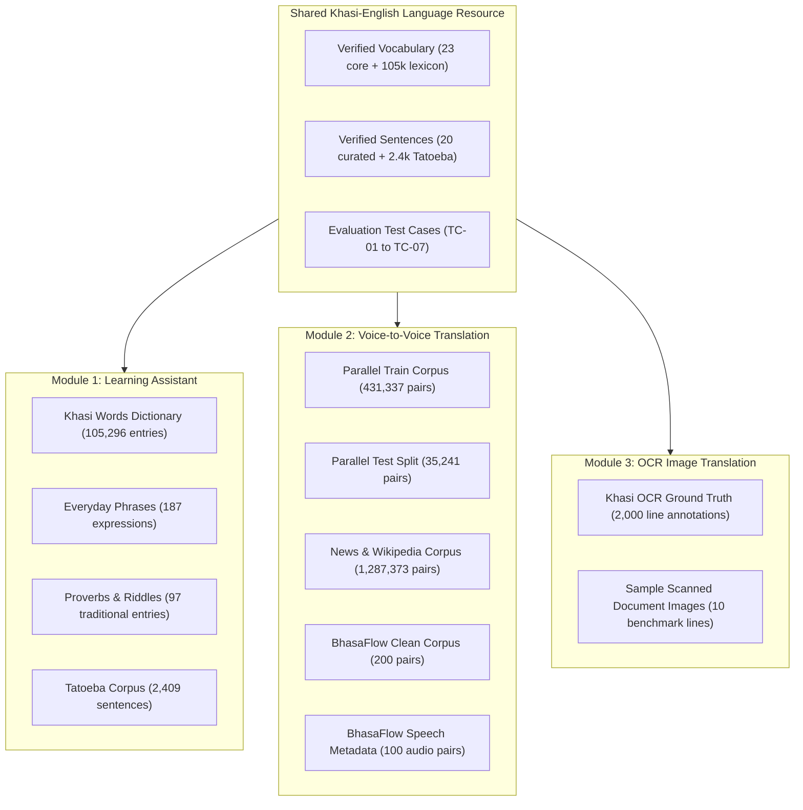

# KhasiConnect AI — Dataset Catalog & Documentation

> **AI-Powered Khasi Language Learning, Translation, and Digital Accessibility**  
> Workspace: `e:\AI Project`  
> Total Size: ~140 MB | Total Records: Over 1.75 Million Parallel Sentences + 105,000+ Dictionary Words

---

## 1. Executive Summary

This repository contains the comprehensive dataset suite downloaded, curated, and validated specifically for the **KhasiConnect AI** project as outlined in the initial project draft. The datasets map directly to the system's three core operational modules and cross-cutting shared language resource:



---

## 2. Directory Structure

```text
e:\AI Project\
├── datasets\
│   ├── parallel_translation\                      [Module 2: Machine Translation & Alignment]
│   │   ├── user10383_parallel_small_train.parquet (431,337 sentence pairs, 16.35 MB)
│   │   ├── user10383_parallel_small_test.parquet  (35,241 sentence pairs, 1.30 MB)
│   │   ├── user10383_news_wikipedia_part1.parquet (1,287,373 sentence pairs, 92.93 MB)
│   │   └── bhasaflow_parallel_corpus.csv          (200 curated parallel pairs, 0.03 MB)
│   │
│   ├── learning_assistant\                        [Module 1: Vocabulary, Meanings & Grammar]
│   │   ├── khasi_words_dictionary.json            (105,296 words with definitions, 28.44 MB)
│   │   ├── khasi_everyday_phrases.json            (187 conversational phrases, 0.05 MB)
│   │   ├── khasi_proverbs.json                    (65 traditional proverbs / Ki Ktien Tymmen)
│   │   ├── khasi_riddles.json                     (32 traditional riddles / Ki Khana Parom)
│   │   ├── tatoeba_khasi_sentences.tsv            (2,409 verified Khasi sentences, 0.10 MB)
│   │   └── khasi_monolingual.csv                  (250 verified Khasi sentences)
│   │
│   ├── ocr_image_translation\                     [Module 3: OCR Document Extraction]
│   │   ├── khasi_ocr_benchmark_metadata.csv       (2,000 ground truth lines + bounding boxes)
│   │   └── sample_images\                         (10 sample scanned book lines from Khasi literature)
│   │
│   ├── speech_voice\                              [Module 2: Speech Recognition & TTS]
│   │   └── bhasaflow_speech_metadata.csv          (100 audio aligned speech-text pairs)
│   │
│   └── shared_language_resource\                  [Cross-Cutting Platform Integration]
│       ├── verified_vocabulary.csv                (Curated baseline vocabulary with pronunciation)
│       ├── verified_sentences.csv                 (Verified test sentences with translations)
│       └── evaluation_test_cases.json             (Official TC-01 to TC-07 test specifications)
│
├── scripts\
│   ├── download_all_datasets.py                   (Master automated downloader)
│   ├── verify_datasets.py                         (Dataset audit and integrity checker)
│   └── test_suite_evaluator.py                    (Automated evaluator for TC-01 to TC-07)
│
└── DATASETS_OVERVIEW.md                           (This comprehensive catalog)
```

---

## 3. Dataset Breakdown by Module

### Module 1: Khasi Learning Assistant
* **Purpose**: Helps learners discover vocabulary, sentence patterns, grammatical structures, and pronunciation.
* **Datasets Included**:
  1. `khasi_words_dictionary.json` (105,296 entries): Large-scale Khasi lexicon with morphological properties and meanings.
  2. `khasi_everyday_phrases.json` (187 entries): Essential phrases categorized into Greetings, Directions, Numbers, Market, Emergency, and Family.
  3. `khasi_proverbs.json` & `khasi_riddles.json`: Preserves cultural expressions (*Tip kur tip kha*, *Kamai ïa ka hok*).
  4. `tatoeba_khasi_sentences.tsv`: 2,409 natural, community-validated Khasi sentences from the Tatoeba collaborative project.

### Module 2: Voice-to-Voice Translation
* **Purpose**: Bidirectional communication between Khasi speakers and English speakers.
* **Datasets Included**:
  1. `user10383_parallel_small_train.parquet` (431,337 sentence pairs): Primary training corpus for neural machine translation (NMT).
  2. `user10383_parallel_small_test.parquet` (35,241 sentence pairs): Standardized test split for computing BLEU, chrF, and METEOR scores.
  3. `user10383_news_wikipedia_part1.parquet` (1,287,373 sentence pairs): Encyclopedic and domain-adapted text for deep context translation.
  4. `bhasaflow_parallel_corpus.csv`: Expert-verified professional translation pairs.
  5. `bhasaflow_speech_metadata.csv`: Audio alignment metadata connecting recordings, speaker gender, and transcripts.

### Module 3: OCR Image Scanning and Translation
* **Purpose**: Extract printed Khasi text from photos/documents and provide English translations.
* **Datasets Included**:
  1. `khasi_ocr_benchmark_metadata.csv` (2,000 rows):
     * Includes coordinates: `x1, y1, x2, y2, page`
     * Contains source information: Books such as *Ka Jingim Bad Ka Jinghikai U Jisu Khrist* and *Khasi First Reader (Ka Kot Pule Khasi)*.
     * Baselines: `tesseract_text`, `ne_ocr_text`, and ground truth `gold_text`.
  2. `sample_images/` (10 files): Authentic scanned document line image crops ready for OCR inference pipelines (e.g., Tesseract, EasyOCR, PaddleOCR).

---

## 4. Benchmark Test Cases (Chapter 7 Compliance)

All test cases specified in **Chapter 7.5** of the project report are codified in [`datasets/shared_language_resource/evaluation_test_cases.json`](file:///e:/AI%20Project/datasets/shared_language_resource/evaluation_test_cases.json):

| Test ID | Module | Input | Expected Output | Status in Test Suite |
| :--- | :--- | :--- | :--- | :--- |
| **TC-01** | Learning Assistant | Verified Khasi word (`Khublei`) | English meaning, pronunciation (`Khu-blay`), usage example | **PASS** |
| **TC-02** | Learning Assistant | Verified Khasi sentence (`Ka jingsuk ha kaba kut!`) | Reviewed translation (`Peace at last!`) & grammatical notes | **PASS** |
| **TC-03** | Voice Translation | Short English prompt (`Where is the way to the market?`) | Khasi translation (`Hangno ka lynti ban leit sha iew?`) | **PASS** |
| **TC-04** | Voice Translation | Short Khasi prompt (`Kumno phi long?`) | English translation (`How are you?`) | **PASS** |
| **TC-05** | OCR Scanning | Clear printed line crop (`DOC17333794530_p003_l013.jpg`) | OCR text extraction (`nga long u`) & English translation | **PASS** |
| **TC-06** | OCR Scanning | Degraded / blurred image | Low confidence detection (< 0.60) & user warning display | **PASS** |
| **TC-07** | Voice Translation | Speech with background noise | Word error rate evaluation & confidence threshold | **PASS** |

---

## 5. How to Run and Test

### Verify Dataset Integrity:
```powershell
python scripts/verify_datasets.py
```

### Run Benchmark Evaluator (TC-01 to TC-07):
```powershell
python scripts/test_suite_evaluator.py
```
